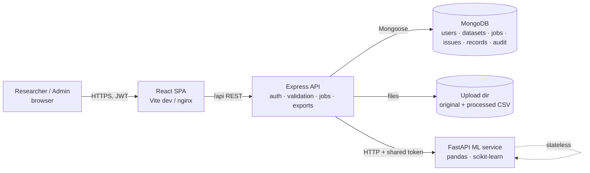
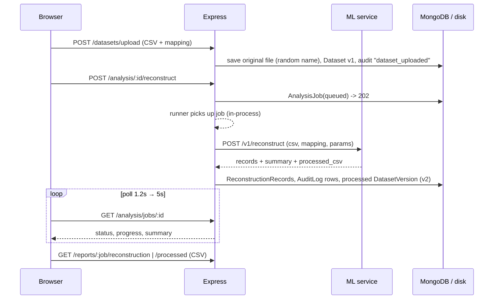
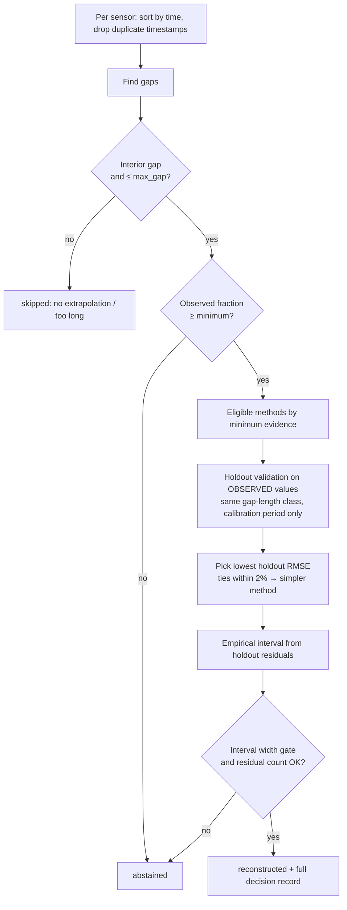
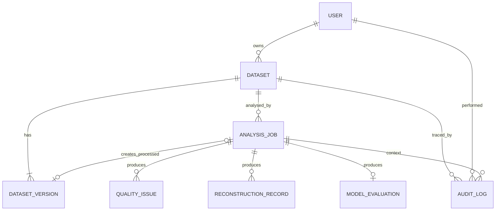

# Architecture

## System overview

Responsibilities are strictly separated:

* **Frontend** renders and calls the REST API only. It never talks to the ML service.
* **Backend** owns identity, authorization (ownership checks on every dataset/job/report), file storage, job lifecycle, persistence, CSV exports and the audit log.
* **ML service** is stateless and pure: it receives CSV text + a column mapping and returns JSON. It trusts the backend through a shared secret header and stores nothing.

## Workflow data flow

## MARE pipeline

## Database ER diagram

## Schema notes (`backend/src/models/index.js`)

| Collection | Purpose | Key fields / indexes |
|---|---|---|
| `User` | Account | unique `email`; `passwordHash` (`select:false`, bcrypt cost 12); `role` researcher\|admin; `preferences` |
| `Dataset` | One upload | `owner` (indexed), `storagePath` (relative, random name), `sha256`, `columns`, `mapping`, `isSynthetic`, `truthPath`, cached `profile`; index `{owner, createdAt}` |
| `DatasetVersion` | Version chain | `{dataset, version}` unique; `kind` original\|processed; `parentVersion`; `job` |
| `AnalysisJob` | Lifecycle of one run | `type`, `params`, `status`, `progress`, `stage`, small `summary`, `error`, timings; index `{dataset, type, createdAt}` |
| `QualityIssue` | One finding per row | `job`, `rowId`, `column`, `category`, `severity`, `method`, `detectedBy`, `reviewStatus` (unreviewed / confirmed_error / dismissed), optional lat/lon |
| `ReconstructionRecord` | One missing value's outcome | `originalValue` (always null: it was missing), `reconstructedValue`, `method`, `status` (reconstructed / abstained / skipped), `evidence`, `uncertainty`, `limitations`, `algorithmVersion`, `reviewStatus` |
| `ModelEvaluation` | Benchmark output | `summaryTable`, `verdict`, full `results`; unique per job |
| `AuditLog` | Append-only history | `action`, `observationState` (original / flagged / reconstructed / manually_reviewed), `rowId`, `column`, `method`, `originalValue`, `newValue`, `uncertainty`, `algorithmVersion`, `datasetVersion`, `job`, `user`; update/delete hooks throw |

**Storage strategy.** No document grows with dataset size: CSV files live on disk (referenced by relative path), per-row results are separate small documents inserted in chunks of 500–1000, and `AnalysisJob.summary` holds only aggregates. Issue storage is capped at 100,000 per job and flagged as truncated.

**Original data is immutable.** Version 1 is the uploaded file. Reconstruction writes a *new* file (version ≥ 2) that keeps every original column byte-for-byte and adds `<var>__estimated`, `__interval_low/high`, `__recovery_method`, `__recovery_status`, and `is_estimated_<var>`.

## Row identifiers

`row_id` is the zero-based position of the data row in the uploaded CSV (blank lines skipped). The backend and ML service use the same definition, so issues, records, map points and audit entries all refer to the same row.
